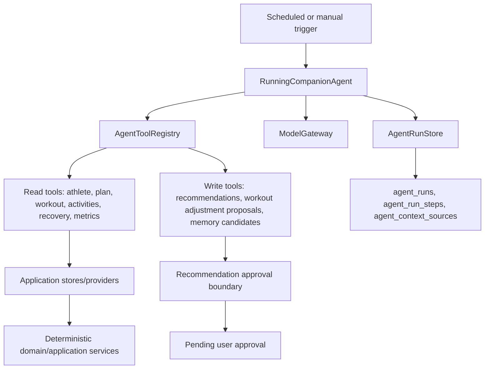

# Agent Runtime Tools

This document describes the MVP Running Companion Agent implementation. The agent is an application-layer orchestrator that reaches project data only through explicit tools, records every run through existing observability tables, and creates proposals instead of applying training changes directly.

## Boundaries

- `RunningCompanionAgent` coordinates prompts, model calls, tool execution, safety checks, and observability.
- `ModelGateway` isolates provider-specific LLM calls. Tests use `FakeModelGateway` and do not require network access.
- `AgentRunStore` records top-level runs, ordered steps, and context sources.
- Read tools return structured payloads and filter by trusted `user_id`.
- Write tools create pending recommendations, workout adjustment proposals, or memory candidates. They do not mutate training plans or durable athlete facts directly.

## Safety

Pain, injury-adjacent, illness, and medical-style prompts are classified before tool execution. In conservative mode, aggressive workout increases are blocked before persistence and the output summary includes non-diagnostic guidance to reduce or stop training when appropriate and consult a medical professional for severe, persistent, or unusual symptoms.
