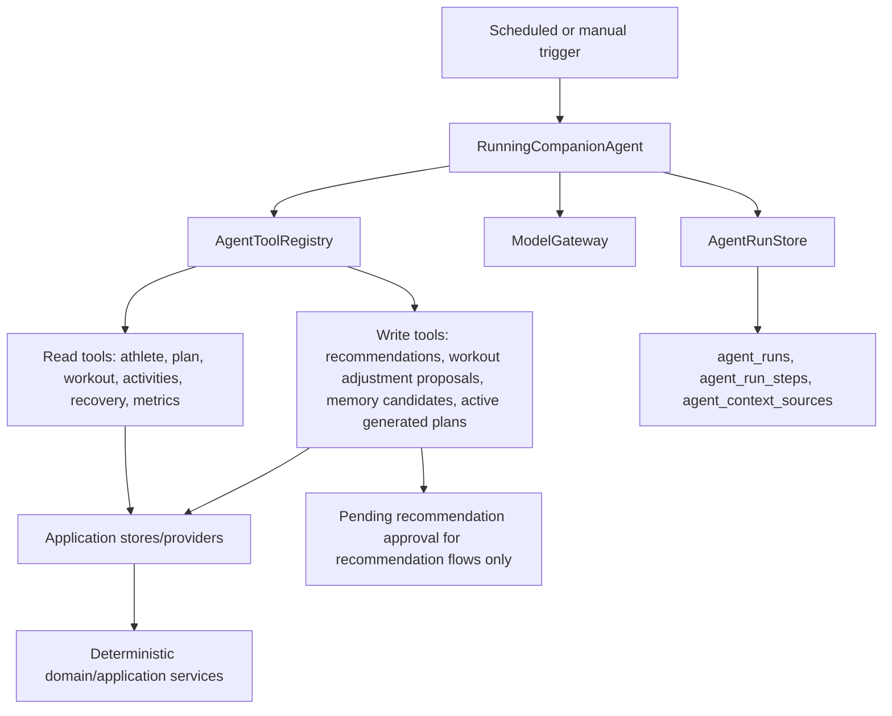

# Agent Runtime Tools

This document describes the MVP Running Companion Agent implementation. The agent is an application-layer orchestrator that reaches project data only through explicit tools, records every run through existing observability tables, and keeps recommendation flows separate from generated training-plan creation.



## Boundaries

- `RunningCompanionAgent` coordinates prompts, model calls, tool execution, safety checks, and observability.
- `ModelGateway` isolates provider-specific LLM calls. Tests use `FakeModelGateway` and do not require network access.
- `AgentRunStore` records top-level runs, ordered steps, and context sources.
- Read tools return structured payloads and filter by trusted `user_id`.
- Write tools create pending recommendations, workout adjustment proposals, memory candidates, or generated active training plans. Training-plan generation creates an active plan directly and supersedes overlapping active plans for the same race.

## Async Runtime

Johnny supports local async execution for product workflows that should not block the current UI request:

- `POST /api/v1/agent-runs/daily-recommendation`
- `POST /api/v1/agent-runs/training-plan-generation`

Each trigger creates an `agent_runs` row with status `queued` and an `agent_tasks` row in the same database transaction. The API returns a compact response with `run_id`, `status`, `workflow_name`, and `poll_url`.

The local queue table is intentionally shaped like a future SQS envelope:

- `task_type`
- `correlation_id`
- `idempotency_key`
- `payload`
- `available_at`
- claim/completion/failure timestamps
- retry count, max attempts, and safe error summary fields

New durable tasks carry `payload.contract_version=1`; existing unversioned rows are legacy version `0`. Workers claim the oldest available *supported* type/version by `available_at`, then `created_at`. Unknown types or versions remain queued for operator inspection instead of being consumed by an incompatible worker. A stale compatible `processing` task can be reclaimed after the configured claim timeout. Retryable failures can be requeued with delay until attempts are exhausted; non-retryable validation, malformed supported payload, and unknown workflow failures are marked failed without storing tracebacks. An old worker does not have this filter, so it must be drained/stopped before version-1 producers are enabled.

## Scheduler And Worker

The local runtime entry point is `scripts/agent_runtime.py`:

```bash
PYTHONPATH=backend ./.venv/bin/python scripts/agent_runtime.py schedule-once
PYTHONPATH=backend ./.venv/bin/python scripts/agent_runtime.py work-drain
```

Make targets wrap the common commands:

- `make agent-schedule-once`
- `make agent-schedule-loop`
- `make agent-work-one`
- `make agent-work-drain`
- `make agent-work-loop`
- `make smoke-agent-local`
- `make smoke-agent-openai`

The scheduler emits a dated Daily Review after the athlete's local 04:00, plus the training-plan daily check. Workout Advice is requested by the athlete. Activity detail fetch/finalize/recheck jobs run only when `JOHNNY_ACTIVITY_DETAILS_ENABLED=true`; with the flag off, existing detail jobs defer instead of losing their checkpoint. Structured coaching generation is separately controlled by `JOHNNY_COACHING_ANALYSIS_V2_ENABLED`. Both flags default off in the production env loader. `/health` and `/ready` expose the declared release build and worker contract versions; compare the actual worker image digest with the release manifest during cutover.

## Generated Training Plans

The `training_plan_generation` workflow selects an explicit race when supplied, otherwise the earliest future primary race, otherwise the earliest future race. `plan_type=base` creates a no-race active plan.

The model may call `createTrainingPlan` in this workflow. `createTrainingPlan` stores an `active` plan immediately. When the generated plan targets a race, existing overlapping active plans for the same race are marked `superseded`. Recommendation creation is handled by separate recommendation or conversation workflows.

If the model proposes an invalid plan, the agent asks for one repair using validation errors. A second invalid response fails the run with inspectable step details.

## Future AWS Mapping

The local scheduler maps to EventBridge or EventBridge Scheduler. `agent_tasks` maps to SQS message envelopes, including idempotency and correlation fields. The worker command maps to a Lambda-style task handler. The current local database queue keeps MVP development deterministic while preserving the production direction.

## Safety

Pain, injury-adjacent, illness, and medical-style prompts are classified before tool execution. In conservative mode, aggressive workout increases are blocked before persistence and the output summary includes non-diagnostic guidance to reduce or stop training when appropriate and consult a medical professional for severe, persistent, or unusual symptoms.
