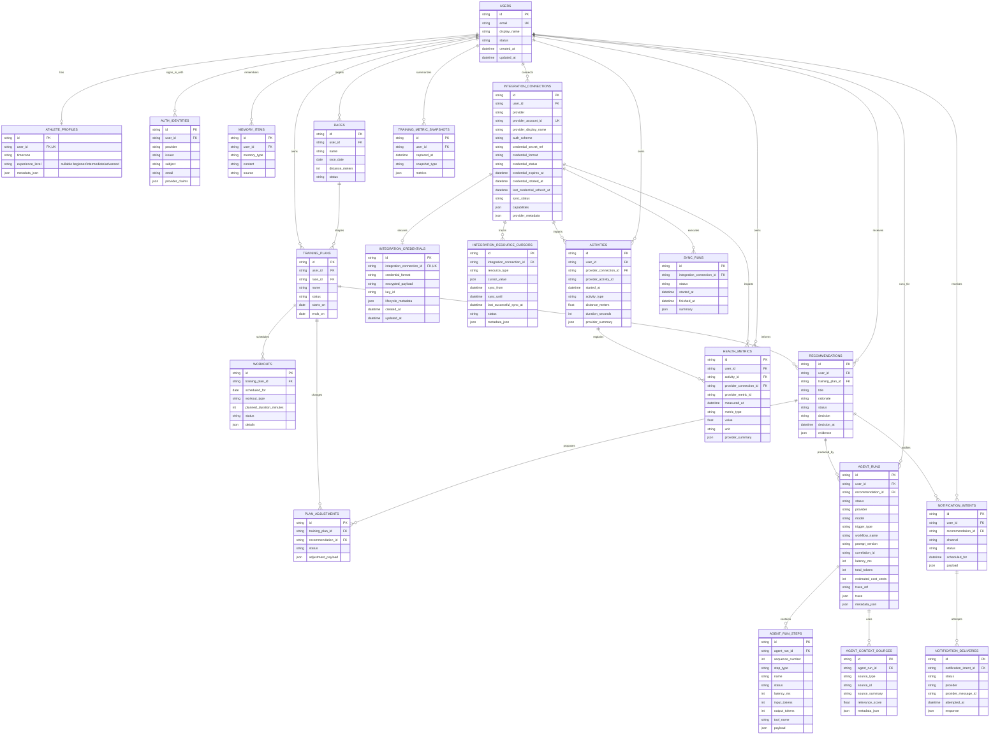

# Database Schema

This document describes the current MVP persistence schema. SQLAlchemy models live in `backend/src/infrastructure/database/models.py`; Alembic uses that metadata as the schema source.

## Design Principles

- UUID string primary keys keep records stable across async jobs, external references, and future services.
- Mutable entities include `created_at` and `updated_at` timestamps through the shared timestamp mixin.
- Queryable, sortable, joinable, and constrained fields are explicit columns.
- JSON columns are reserved for flexible provider payloads, evidence, metadata, traces, and compact summaries.
- Raw secrets are never stored directly. Integration connection metadata stores references to a secret store or uncommitted local token-store boundary. Private/self-hosted Garmin sync may store encrypted session/token payloads in dedicated credential records when that mode is configured; Garmin passwords are used only once in memory for session exchange and then discarded. Raw passwords, cookies, unencrypted token-store JSON, and unencrypted provider tokens must not be stored.

## Entity Relationship Overview

## Domain Areas

### Identity and Athlete Context

`users` is the stable Johnny account record. External sign-in providers are modeled through `auth_identities`, keyed by provider, issuer, and subject. This keeps Google, GitHub, Firebase-brokered auth, Auth0, Clerk, or future SSO providers separate from Johnny's application user ID.

`athlete_profiles` stores user-level running context. `memory_items` stores durable personalization facts that future agent flows can read through application tools.

### Training Plan and Recommendation Loop

`races`, `training_plans`, `workouts`, and `plan_adjustments` model the plan side of the MVP loop. `recommendations` records the user-facing AI recommendation and the user's decision. `plan_adjustments` can link back to the recommendation that proposed the change.

### Integration and Garmin Data

`integration_connections` represents access to a provider account, not a specific data stream. For Garmin Connect, use:

- `provider`: `garmin_connect`
- `auth_scheme`: `garminconnect_tokenstore`
- `credential_format`: `garminconnect-session-json`
- `credential_secret_ref`: empty for private encrypted-session mode, or a non-sensitive external credential reference for future modes

Private/self-hosted `garminconnect` mode stores encrypted Garmin session/token payloads in `integration_credentials`. Each record belongs to one `integration_connections` row and stores `credential_format`, `encrypted_payload`, `key_id`, timestamps, and only non-sensitive lifecycle metadata such as Garmin region or display name. The local/private MVP Fernet key comes from `GARMIN_CREDENTIAL_MASTER_KEY`; `GARMIN_CREDENTIAL_KEY_ID` identifies the active key for rotation/audit. Garmin credential operations fail with a configuration error if this key is absent or invalid, while unrelated app behavior remains available.

The connection row remains metadata: it must not contain Garmin passwords, cookies, unencrypted token-store JSON, or unencrypted provider tokens. Garmin passwords are used only once in memory for session exchange and then discarded.

`integration_resource_cursors` tracks independent sync progress for each provider resource, such as `activities`, `sleep`, `hrv`, `resting_heart_rate`, `stress`, and `body_battery`. This lets one resource fail or lag without making the whole connection stale.

`activities` and `health_metrics` store normalized imported data. Provider-specific fields that are useful for debugging but not central to querying stay in `provider_summary`.

### AI Observability

`agent_runs` is the top-level execution record. It keeps queryable dashboard fields such as trigger, workflow, prompt version, provider, model, token usage, latency, cost, summaries, errors, and trace references.

`agent_run_steps` records ordered context-building, model-call, tool-call, formatting, and safety-check steps. This avoids parsing one large trace blob for latency and failure analysis.

`agent_context_sources` records the evidence used by an agent run, such as activity, health metric, plan, memory, race, or workout context. This supports future "why did the AI recommend this?" explanations.

### Sync, Outbox, and Notifications

`sync_runs` records provider sync job attempts. `outbox_events` supports reliable asynchronous side effects. `notification_intents` records planned notifications and `notification_deliveries` records provider delivery attempts.

## Constraint Highlights

- `auth_identities` enforces uniqueness by provider, issuer, and subject.
- `integration_connections` enforces one provider account per provider/provider account identifier.
- `integration_credentials` enforces one encrypted credential payload per integration connection.
- `integration_resource_cursors` enforces one cursor per integration connection and resource type.
- `activities` deduplicates by provider connection and provider activity identifier.
- `health_metrics` deduplicates provider metrics by provider connection and provider metric identifier.
- `agent_run_steps` enforces one step per agent run and sequence number.
- `recommendations` constrains status and decision values.
