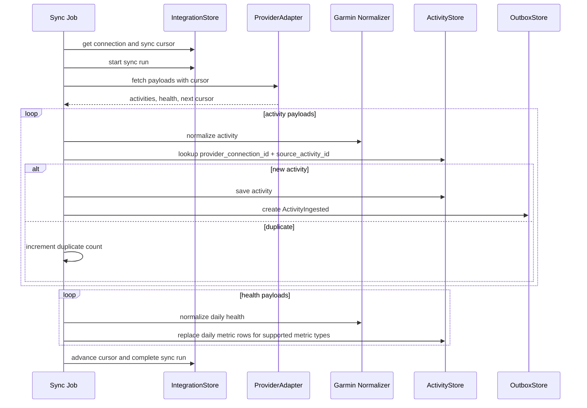
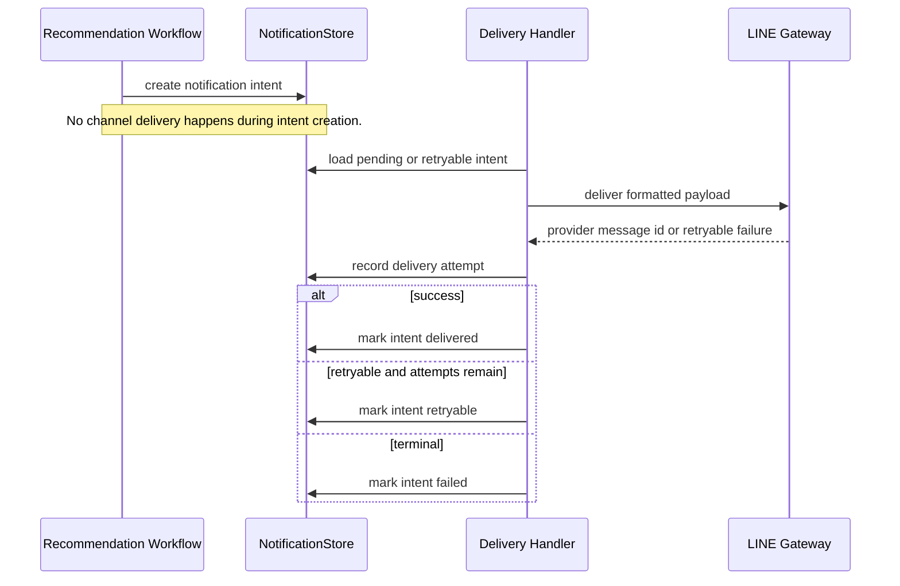

# Integrations and Notifications

This document describes how provider ingestion and notification delivery use the current persistence schema.

## Provider Sync Flow

## Garmin Connect Experimental Login

`POST /api/v1/integrations/garmin/connect` is the Garmin-specific connection endpoint. It accepts Garmin email, password, and an explicit `global` or `china` region, then delegates credential validation and account discovery to a Garmin login adapter. The endpoint never accepts a user-entered Garmin provider account ID; it persists the provider account identity returned by Garmin and stores only the Garmin profile display name for account recognition.

The production adapter uses the pinned `garminconnect==0.3.11` dependency. The password is used only during the in-memory exchange. Session/token material is serialized from the `garminconnect` client, encrypted through the integration credential cipher, and stored in `integration_credentials`; `integration_connections` remains metadata and keeps `credential_secret_ref` empty for this mode.

Garmin sync decrypts the stored session payload only inside the handler call, passes that JSON string directly to `Garmin.login(tokenstore=...)`, and never writes decrypted token JSON to disk. After each successful resource fetch, the adapter serializes the refreshed `garminconnect` session and saves it back through the encrypted credential store. Normal tests override the Garmin adapters and credential cipher so they remain network-free; live Garmin validation remains opt-in through the schema probe.

Garmin sync treats expired, revoked, MFA-blocked, or otherwise credential-blocked sessions as a reauth state: the connection remains connected for historical provenance, but `credential_status` becomes `requires_reauth` and future sync work must wait for a user/admin reconnect action. Garmin rate limits and temporary blocking errors are recorded as failed sync summaries with redacted error text and provider backoff metadata when available; they do not mark credentials as invalid unless the adapter raises a credential-blocked error.

`POST /api/v1/integrations/connections/{connection_id}/sync` triggers a synchronous manual Garmin sync for the active connection. It returns the same connection response shape as Garmin connect, including resource counts, redacted errors, timestamps, partial-failure warnings, and reauth state. If the connection already has a running sync and a started sync run exists, the endpoint returns that running status instead of starting another sync; if the connection is marked running without a matching started run, it returns a conflict.

`DELETE /api/v1/integrations/connections/{connection_id}` disconnects a Garmin connection by deleting its encrypted credential row and marking the connection `disconnected`. Imported Garmin activities and daily health metrics keep their `provider_connection_id` so historical provenance remains available.

`POST /api/v1/integrations/connections/{connection_id}/admin-token-import` is the backend-only MFA escape hatch for the MVP. It requires `X-Johnny-Admin-Token` to match `JOHNNY_ADMIN_TOKEN`, encrypts the supplied Garmin session payload, stores only non-sensitive lifecycle metadata, and returns the normal redacted connection response.

## Notification Flow

## Schema Notes

- `integration_connections.credential_secret_ref` stores only a reference to a token store or secret manager entry. It must not contain Garmin email/password, access tokens, refresh tokens, cookies, or session payloads. Private/self-hosted `garminconnect` mode may store encrypted session/token payloads in a dedicated credential store; Garmin passwords are used only once in memory for session exchange and then discarded. Raw passwords, cookies, unencrypted token-store JSON, and unencrypted provider tokens must not appear in connection metadata, logs, sync summaries, provider summaries, or API responses.
- Disconnect deletes the encrypted credential record, not imported data. Admin token import writes a fresh encrypted credential and marks credentials active without adding a public token-import UI.
- Garmin ingestion is compatible with `garminconnect` payload shapes, but the database schema remains provider-neutral through `provider`, `provider_connection_id`, provider IDs, JSON summaries, and resource cursors.
- `activities` deduplicates imported activities by `provider_connection_id` and `provider_activity_id`.
- Daily health payloads are mapped into the supported `DailyHealthMetrics` fields and persisted as one row per metric type for each day, matching the existing `health_metrics` table design.
- `outbox_events` records `ActivityIngested` only for newly saved provider activities.
- `notification_intents` records what should be sent; `notification_deliveries` records each delivery attempt and provider response.
