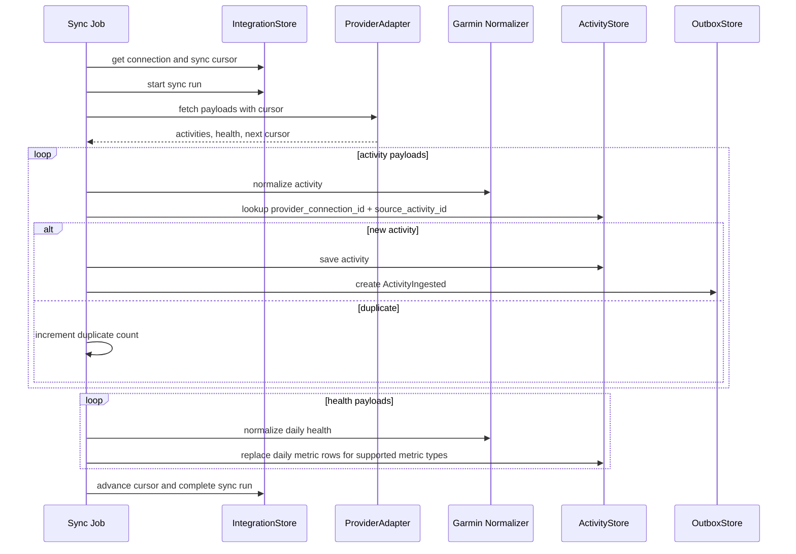
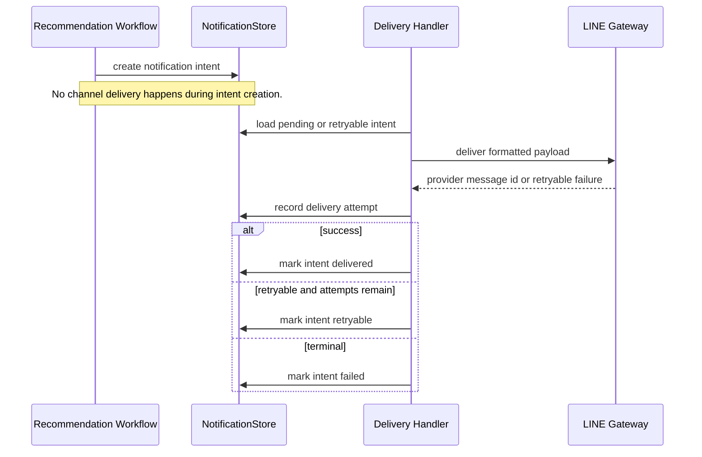

# Integrations and Notifications

This document describes how provider ingestion and notification delivery use the current persistence schema.

## Provider Sync Flow

## Notification Flow

## Schema Notes

- `integration_connections.credential_secret_ref` stores only a reference to a token store or secret manager entry. It must not contain Garmin email/password, access tokens, refresh tokens, cookies, or session payloads. Private/self-hosted `garminconnect` mode may store encrypted session/token payloads in a dedicated credential store; Garmin passwords are used only once in memory for session exchange and then discarded. Raw passwords, cookies, unencrypted token-store JSON, and unencrypted provider tokens must not appear in connection metadata, logs, sync summaries, provider summaries, or API responses.
- Garmin ingestion is compatible with `garminconnect` payload shapes, but the database schema remains provider-neutral through `provider`, `provider_connection_id`, provider IDs, JSON summaries, and resource cursors.
- `activities` deduplicates imported activities by `provider_connection_id` and `provider_activity_id`.
- Daily health payloads are mapped into the supported `DailyHealthMetrics` fields and persisted as one row per metric type for each day, matching the existing `health_metrics` table design.
- `outbox_events` records `ActivityIngested` only for newly saved provider activities.
- `notification_intents` records what should be sent; `notification_deliveries` records each delivery attempt and provider response.
